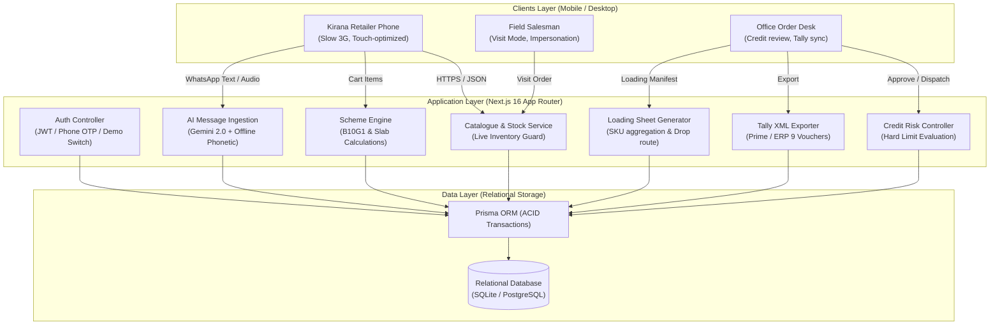
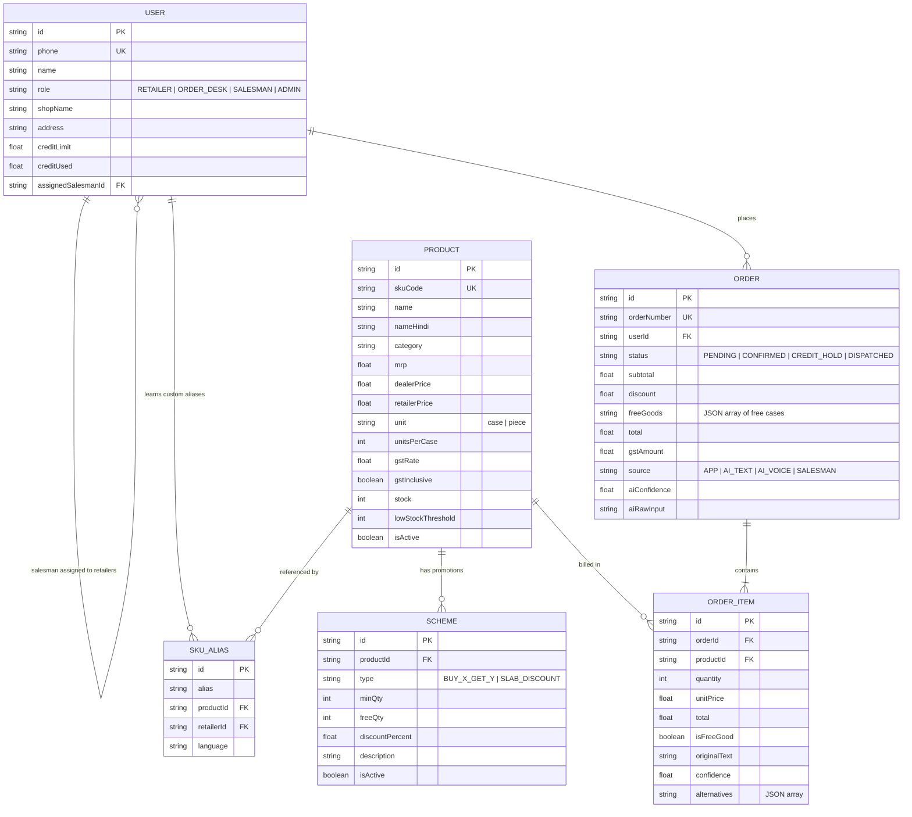
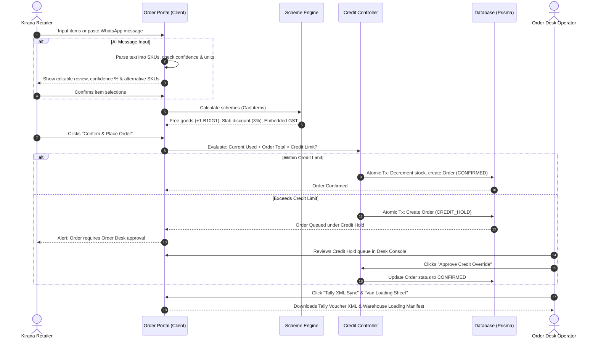
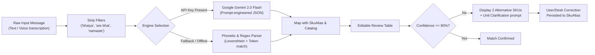

# Distributor Order Management System (Jabalpur FMCG Hub)

[](https://nextjs.org/)
[](https://react.dev/)
[](https://tailwindcss.com/)
[](https://www.prisma.io/)
[](https://www.typescriptlang.org/)
[]()

An end-to-end B2B order management system engineered for **Company A**, an FMCG distributor in **Jabalpur, Madhya Pradesh**, operating with 70 staff (including 18 field salesmen), serving **1,800 kirana shops** across 4 packaged food and home care brands with an annual turnover of **₹85–100 Crore**.

---

## Table of Contents
- [1. Business Case & Problem Statement](#1-business-case--problem-statement)
- [2. System Architecture](#2-system-architecture)
- [3. Entity-Relationship Data Model](#3-entity-relationship-data-model)
- [4. End-to-End Order & Credit Lifecycle](#4-end-to-end-order--credit-lifecycle)
- [5. Core Modules & Engineering Deep Dives](#5-core-modules--engineering-deep-dives)
  - [A. Scheme Engine ("The Hard Part")](#a-scheme-engine-the-hard-part)
  - [B. AI Message Order Parser & Guardrails](#b-ai-message-order-parser--guardrails)
  - [C. Credit Risk Engine & Hold Review](#c-credit-risk-engine--hold-review)
  - [D. Tally Prime / ERP 9 XML Synchronization](#d-tally-prime--erp-9-xml-synchronization)
  - [E. Warehouse Truck Loading & Store Drop Manifest](#e-warehouse-truck-loading--store-drop-manifest)
  - [F. 14-Day Inactive Kirana Churn Prevention](#f-14-day-inactive-kirana-churn-prevention)
- [6. UI/UX Design for 3G Kirana Phones](#6-uiux-design-for-3g-kirana-phones)
- [7. Verification Test Suite (16/16 Passing)](#7-verification-test-suite-1616-passing)
- [8. Quick-Start & Local Deployment Guide](#8-quick-start--local-deployment-guide)
- [9. Demo Reviewer Accounts](#9-demo-reviewer-accounts)
- [10. Project Directory Structure](#10-project-directory-structure)

---

## 1. Business Case & Problem Statement

### The Status Quo (Today)
Field salesmen write orders in physical notebooks or receive unstructured WhatsApp text messages, photos of handwritten slips, and Hindi voice notes from kirana owners. The next morning, an office team of 6 clerks manually re-types these notes into Tally ERP. Because salesmen and shopkeepers lack real-time visibility into warehouse stock and active schemes at the counter, lines are cut later during dispatch.

### The Financial Leakage: ₹52.5 Lakh / Year
At 600 orders/day across 300 business days (1,80,000 orders/year averaging ₹5,000 each = ₹90 Crore annual GMV):
1. **Wrong Items & Redeliveries:** 5% of orders require redelivery or return:
   $$1,80,000 \times 5\% = 9,000 \text{ orders} \times ₹350 = \mathbf{₹31.5\text{ Lakh/year}}$$
2. **Order Entry Labor:** 6 office clerks typing into Tally:
   $$6 \times ₹2.6\text{ Lakh} = \mathbf{₹15.6\text{ Lakh/year}}$$
3. **Stock-Outs Discovered Post-Order:** Cuts 1% of sales at 6% distributor margin:
   $$₹90\text{ Lakh} \times 6\% = \mathbf{₹5.4\text{ Lakh/year}}$$
4. **Total Annual Cost:** **₹52.5 Lakh / year** against a project budget of ₹7.0 Lakh (7.5× ROI in Year 1).

---

## 2. System Architecture



---

## 3. Entity-Relationship Data Model



---

## 4. End-to-End Order & Credit Lifecycle



---

## 5. Core Modules & Engineering Deep Dives

### A. Scheme Engine ("The Hard Part")
FMCG schemes in Central India require strict algebraic rules:
1. **Buy X Get Y Free:**
   $$\text{Qualified Slabs} = \left\lfloor \frac{\text{Ordered Quantity}}{\text{minQty}} \right\rfloor$$
   $$\text{Free Goods Cases} = \text{Qualified Slabs} \times \text{freeQty}$$
   *Partial Slab Protection:* Ordering 15 cases of `SKU-BS-075` (Buy 10 Get 1 Free) grants exactly **1 free case** (the 5 remaining cases do not qualify for another free unit). Ordering 20 cases grants **2 free cases**. Free goods are created as discrete `OrderItem` rows with `unitPrice = 0` and `isFreeGood = true`.
2. **Slab Discounts:**
   $$\text{If } \text{Quantity} \ge \text{minQty}: \quad \text{Discount} = \text{round}\left( \frac{\text{Line Total} \times \text{discountPercent}}{100}, 2 \right)$$
   Ordering 5 cases of `SKU-DT-1KG` at ₹110/case yields $550 \times 3\% = \mathbf{-₹16.50}$ invoice discount.
3. **Embedded 18% GST Backout:**
   $$\text{GST Amount} = \text{round}\left( \frac{\text{Gross Total} \times 18}{118}, 2 \right)$$

---

### B. AI Message Order Parser & Guardrails
Shopkeepers order via WhatsApp messages, voice notes, and photos:
> *"bhaiya 5 peti biscuit chhota, 2 peti washing powder 1 kilo, chai patti 250 wala 1 peti."*



#### Guardrails Implemented:
- **Traceability:** Displays the original words for each extracted line item.
- **Confidence Scoring:** High ($\ge 80\%$) vs Amber ($< 80\%$).
- **Alternative SKU Chips:** When ambiguous, presents 2 alternative SKUs with 1-click swap buttons.
- **Unclear Unit Resolution:** Differentiates between *case* (`peti`, `dabba`) and *piece* (`packet`). Unclear units are **asked, not guessed**.
- **Human-in-the-Loop:** No order is placed without user confirmation.

---

### C. Credit Risk Engine & Hold Review
- Each kirana has an approved credit limit (e.g. *Gupta Kirana*: ₹50,000 limit, ₹48,200 used $\to$ **₹1,800 available**).
- When Gupta Kirana orders ₹2,750 of stock, the order is automatically flagged as **`CREDIT_HOLD`**.
- The office Order Desk console isolates credit holds in a dedicated filter tab with an **Approve Credit Override** action.

---

### D. Tally Prime / ERP 9 XML Synchronization
Replaces manual typing by generating standard Tally XML import vouchers:
- XML Envelope: `ENVELOPE` $\to$ `BODY` $\to$ `IMPORTDATA` $\to$ `REQUESTDATA` $\to$ `TALLYMESSAGE`.
- Voucher: `<VOUCHER VCHTYPE="Sales Order" ACTION="Create">`.
- Parties: `<PARTYLEDGERNAME>` debited with net order total.
- Stock: `<ALLINVENTORYENTRIES.LIST>` with `<ACTUALQTY>` vs `<BILLEDQTY>` (for free scheme goods).

---

### E. Warehouse Truck Loading & Store Drop Manifest
To prevent warehouse dispatch bottlenecks:
1. **Warehouse SKU Loading Summary:** Aggregated total cases across all confirmed orders grouped by SKU (e.g. Glucose Biscuit: 45 billed cases + 4 free cases = **49 cases to load**).
2. **Retail Store Delivery Drops:** Sequence of deliveries for van drivers with stop numbers, shop names, street addresses, phone numbers, and case totals.

---

### F. 14-Day Inactive Kirana Churn Prevention
At 600 orders/day across 1,800 kiranas, an active store orders every 3 days. A store with no order in $\ge 14$ days indicates customer churn. The dashboard displays:
- Store name, owner, phone, and address.
- Days since last order & last order amount.
- Assigned field salesman.
- Quick actions: **Call**, **WhatsApp**, and **Visit Order** (Salesman mode: switches customer persona and loads catalogue on the spot).

---

## 6. UI/UX Design for 3G Kirana Phones

- **Sub-3s First Load:** Minimal JavaScript bundle with pre-rendered server components.
- **$\ge 44\text{px}$ Tap Targets:** Sized for shopkeepers operating phones with one hand between serving customers.
- **Bilingual Interface:** Instant English $\leftrightarrow$ Hindi toggle (`हिंदी`) across the entire portal.
- **Restrained FMCG Color Palette:**
  - Deep Navy (`#1E3A8A`): Top header and brand identity.
  - Emerald Green (`#059669`): Scheme benefits, discounts, and in-stock badges.
  - Amber (`#D97706`): Low stock alerts and credit review warnings.
  - Coral Red (`#DC2626`): Out of stock flags and credit hold indicators.
  - Slate White (`#F8FAFC`): Crisp, glare-resistant background.

---

## 7. Verification Test Suite (16/16 Passing)

Run the test runner to verify core logic:
```bash
npm test
```

```text
=======================================================
 DISTRIBUTOR ORDER MANAGEMENT SYSTEM - TEST SUITE
=======================================================

📦 1. SCHEME ENGINE TESTS:
  ✅ PASS: Buy 10 get 1 free: 10 cases yields exactly 1 free case
  ✅ PASS: Free goods summary contains 1 free case
  ✅ PASS: Buy 10 get 1 free: 15 cases yields 1 free case (5 remaining do not qualify)
  ✅ PASS: Buy 10 get 1 free: 25 cases yields 2 free cases
  ✅ PASS: Buy 10 get 1 free: 9 cases yields 0 free cases
  ✅ PASS: SLAB_DISCOUNT: 5 cases yields 3% discount (₹15.23)
  ✅ PASS: Net total correctly subtracts slab discount
  ✅ PASS: SLAB_DISCOUNT: 4 cases yields 0 discount (min 5 required)

🤖 2. AI NATURAL LANGUAGE ORDER PARSER TESTS:
  ✅ PASS: Parsed 3 distinct lines from raw order message (found 3)
  ✅ PASS: Line 1: '5 peti biscuit chhota' -> 5 cases of SKU-BS-075
  ✅ PASS: Line 2: '2 peti washing powder 1 kilo' -> 2 cases of SKU-DT-1KG
  ✅ PASS: Line 3: 'chai patti 250 wala 1 peti' -> 1 case of SKU-TE-250
  ✅ PASS: Unit 'peti' correctly standardized to 'case'
  ✅ PASS: Ambiguous unit ('packet') flagged for user clarification

💳 3. CREDIT LIMIT & RISK CONTROL TESTS:
  ✅ PASS: Order of ₹5000 exceeds remaining credit limit of ₹1800
  ✅ PASS: Over-limit order is routed to 'CREDIT_HOLD' status

=======================================================
 RESULTS: 16 PASSED | 0 FAILED
=======================================================
🎯 ALL TESTS PASSED SUCCESSFULLY!
```

---

## 8. Quick-Start & Local Deployment Guide

### Prerequisites
- **Node.js:** v20.x or higher
- **npm:** v10.x or higher

### Step 1: Install Dependencies
```bash
npm install
```

### Step 2: Initialize Database & Seed FMCG Sample Data
```bash
npx prisma db push
npm run db:seed
```

### Step 3: Run the Verification Test Suite
```bash
npm test
```

### Step 4: Start the Development Server
```bash
npm run dev
```
Open **`http://localhost:3000`** in your browser.

---

## 9. Demo Reviewer Accounts

The application features a **1-click Persona Switcher** in the top navigation bar. Alternatively, sign in at `/login` with phone and mock OTP `123456`:

| Persona | Shop Name / User | Phone | Review Scenario |
| :--- | :--- | :--- | :--- |
| **Retailer** | **Sharma General Store** | `9999999701` | Healthy credit (₹62.5k avail); catalogue browsing, scheme calculations, order checkout. |
| **Retailer** | **Gupta Kirana** | `9999999702` | **Credit Hold trigger** (only ₹1,800 credit avail). Placing orders $> ₹1,800$ triggers `CREDIT_HOLD`. |
| **Order Desk** | **Priya Sharma** | `9999999901` | Credit hold review & approval, Tally Prime XML export, Van loading sheet. |
| **Salesman** | **Vikram Singh** | `9999999801` | Field visit orders, 14-day inactive kirana follow-up. |
| **Admin** | **Rajesh Kumar** | `9999999999` | Owner-director; master control and distributor analytics. |

---

## 10. Project Directory Structure

```text
distributor-order-management-system/
├── prisma/
│   ├── schema.prisma          # SQLite/PostgreSQL relational data model
│   └── seed.ts                # Realistic Jabalpur FMCG seed data
├── scripts/
│   ├── test-runner.ts         # Automated test suite (16 tests)
│   └── generate_docx.py       # Technical Design Document generator
├── src/
│   ├── app/
│   │   ├── api/
│   │   │   ├── ai/parse/      # Natural language message parser
│   │   │   ├── aliases/       # Learned colloquial SKU alias mappings
│   │   │   ├── desk/          # Analytics, Tally XML & Van loading sheet
│   │   │   ├── orders/        # Order placement & scheme calculation
│   │   │   └── products/      # Catalogue & inventory stock queries
│   │   ├── login/page.tsx     # Mobile OTP login screen
│   │   ├── globals.css        # Tailwind styles & typography
│   │   ├── layout.tsx         # Root layout with Toast & Metadata
│   │   └── page.tsx           # Main application view with tab orchestration
│   ├── components/
│   │   ├── ai-order-modal.tsx # Natural language WhatsApp & voice parser modal
│   │   ├── cart-drawer.tsx    # Slide-over cart with live scheme breakdowns
│   │   ├── catalogue-view.tsx # Retailer product grid with stock status
│   │   ├── inactive-retailers-view.tsx # 14-day kirana churn dashboard
│   │   ├── navbar.tsx         # Bilingual header & 1-click persona switcher
│   │   ├── order-desk-view.tsx# Central desk console with Tally export
│   │   ├── orders-view.tsx    # Past orders & 1-click repeat order
│   │   └── ui/                # Accessible shadcn/ui components (44px tap targets)
│   ├── lib/
│   │   ├── ai-parser.ts       # Gemini 2.0 + offline phonetic order parser
│   │   ├── cart-context.tsx   # React cart state manager
│   │   ├── prisma.ts          # Singleton Prisma client
│   │   ├── scheme-engine.ts   # Buy-X-Get-Y & slab discount engine
│   │   └── utils.ts           # Currency (₹), date, and styling helpers
│   └── types/                 # TypeScript type definitions
├── TECHNICAL_DESIGN_DOCUMENT.md # Technical Design Document (Markdown)
├── TECHNICAL_DESIGN_DOCUMENT.docx # Technical Design Document (Word format)
├── deployment.md              # Local run & cloud deployment instructions
├── submission.zip             # Submission archive (< 25 MB)
└── package.json               # Project manifest & npm scripts
```
